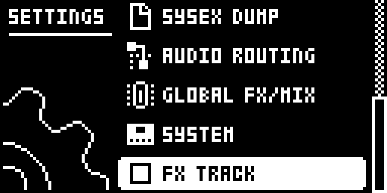

# FX Track

## Overview

The Digitakt has no effects track of its own, but it already lets MIDI control its effects. On the channel set in **SETTINGS > MIDI CONFIG > CHANNELS > FX CONTROL CH**, incoming control changes set the delay, reverb, compressor and External Mixer. A MIDI track’s own control changes only leave by MIDI OUT and USB, though, so the sequencer can’t reach the effects without a cable from MIDI OUT back to MIDI IN.

With **SETTINGS > FX TRACK** ticked, a control change that a MIDI track sends on FX CONTROL CH for one of the effects’ CC numbers goes straight into the Digitakt’s own MIDI handling instead, as if it had come in through MIDI IN, and is not sent out. Give a MIDI track that channel and point its CC SEL slots at the effects: its CC VAL knobs, parameter locks and LFO then play the delay, reverb, compressor and mixer through the sequencer, with the instrument’s own tempo, swing and step timing.

Unticked, every MIDI message goes out exactly as stock.

Version **0.1.0-experimental** for Digitakt I OS **1.54** on Core 2.1.

## Controls

| Control | Action |
| --- | --- |
| SETTINGS > FX TRACK | Ticked: the MIDI tracks’ effects CCs on FX CONTROL CH stay inside and set the effects. Unticked: stock. YES toggles it; RIGHT ticks and LEFT unticks it. Unticked at every power-on. |
| MIDI CONFIG > CHANNELS > FX CONTROL CH | Stock setting: the channel the effects listen on. OFF disables FX Track too. |
| MIDI track CHAN, CC SEL, CC VAL, LFO | Stock. A MIDI track whose CHAN equals FX CONTROL CH becomes the effects track. |

### Message map

The effects’ CC numbers are the stock FX CONTROL CH map of OS 1.54, measured in the emulator. FX Track takes only these, on FX CONTROL CH; each is consumed (not sent out) and passed to the stock handling:

| CC | Setting |
| --- | --- |
| 24-31 | Reverb: PRE, DECAY, FREQ, GAIN, HPF, LPF, (30) the on/off switch for the reverb after the compressor, (31) VOL |
| 85-92 | Delay: TIME, X (ping-pong), WIDTH, FEEDBACK, HPF, LPF, REVERB send, VOL |
| 102-109 | External Mixer: IN L LEV, IN L PAN, IN R LEV, IN R PAN, IN L DEL, IN R DEL, IN L REV, IN R REV |
| 111-119 | Compressor |

Every other message the MIDI track sends goes out as stock: notes, other CCs (All Sound Off, CC 120, among them), pitch bend, aftertouch and program changes. Messages on other channels are never touched.

## Usage

The row is in the stock SETTINGS menu. FX CONTROL CH is in SETTINGS > MIDI CONFIG > CHANNELS, and the MIDI track’s CHAN, CC SEL and CC VAL are its SRC, AMP and FLTR pages.

### Where to find it

SETTINGS > FX TRACK

1. Use a build containing FX Track for the original Digitakt on OS 1.54.
2. Press SETTINGS and go down to FX TRACK, below SYSTEM, with UP/DOWN.
3. Press YES to tick or untick it. RIGHT ticks it and LEFT unticks it.
4. Set FX CONTROL CH in SETTINGS > MIDI CONFIG > CHANNELS, and give a MIDI track the same CHAN.

### Quick tutorial: MIDI track H as an effects track

1. In SETTINGS > MIDI CONFIG > CHANNELS, set TRACK H CHANNEL to OFF and FX CONTROL CH to 16, so no track listens on that channel.
2. Open SETTINGS and tick FX TRACK.
3. Select MIDI track H (TRK + trig 16). On its SRC page press FUNC + knob A to switch CHAN on and set it to 16.
4. On the AMP page (CC Select) set SEL1 to 85 (delay TIME) and SEL2 to 88 (delay FDBK), or any effects CC from the list.
5. On the FLTR page (CC Value) turn VAL1 and VAL2: the delay follows, and nothing is sent out of MIDI OUT for those CCs.
6. Record lock trigs with parameter locks on VAL1 and VAL2, or set the track’s LFO to a CC VAL, and press PLAY: the delay changes per step.

For send throws on the external inputs, use CC 106-109 (IN L/R DEL and REV) instead.

## Compatibility and limitations

Requires Core 2.1. Built for OS 1.54 only.

- **Not saved.** FX TRACK starts unticked (stock) at every power-on. Projects store nothing for it; the MIDI track’s CHAN, CC SEL and locks are ordinary project data and load the same on a stock OS, where they simply go out of MIDI OUT.
- **Stock receive settings apply.** The messages are handled like a control change arriving at the input: they need FX CONTROL CH set, RECEIVE CC/NRPN ticked and PORT CONFIG > INPUT FROM including MIDI or USB. With INPUT FROM set to neither, they are dropped.
- **Track channels.** As through a MIDI cable, the messages also reach any audio or MIDI track whose TRACK CHANNEL equals FX CONTROL CH. Set that track channel to OFF, as in the tutorial.
- **Notes still go out.** A trig on the effects track sends its note on that channel. Use lock trigs for parameter locks without notes, or keep the channel unused by external gear.
- **Resolution.** CC values have 128 steps, like the knobs; the delay and reverb smooth the changes as they do for knob turns.
- **Timing.** A taken message is handed to the Digitakt’s MIDI task at the next audio block, at most about 0.7 ms later. At most 127 messages wait at once; more are dropped (a MIDI track sends far fewer per step).
- **What it patches.** One 6-byte `jsr` site at the start of the function that adds a message to the MIDI tracks’ output buffer (0x400e0dac on OS 1.54), plus an `ev_render_out` handler that posts the taken messages. It overlaps no other Modwerk module’s bytes.
- **Stock flows.** It adds one SETTINGS row (`settings:FX TRACK`) and changes no stock page, gesture or saved data. Unticked, the MIDI output is stock.

## Tests and measurements

See [TESTING.md](TESTING.md) for the exact evidence and the checks still open. The emulator results cover the message path and the SETTINGS row; they do not prove audible output, timing on the unit or behaviour beside every other module on hardware.

## Authorship and licences

draadpiraat: design and code, with Claude Code assistance. Core 2.1, the hook bus and the memory map: irpina (elekloader) and Em D (digikit).
Code: [GPL-3.0-or-later](LICENSE). Screens show Elektron’s interface solely to document the modification. No Elektron firmware is included.

## Screens and audio

These captures show the **OS 1.54 build with Core 2.1 and this module alone**, booted in the pinned digiemu with firmware-native drawing. See [capture provenance](media/capture.json) for hashes and panel inputs. No audio demonstration is supplied yet.

Press SETTINGS and go down to FX TRACK, below SYSTEM. Unticked, the MIDI tracks’ control changes leave by MIDI OUT and USB as on the stock OS.

Press YES or RIGHT to tick it. A MIDI track on FX CONTROL CH now plays the effects.
